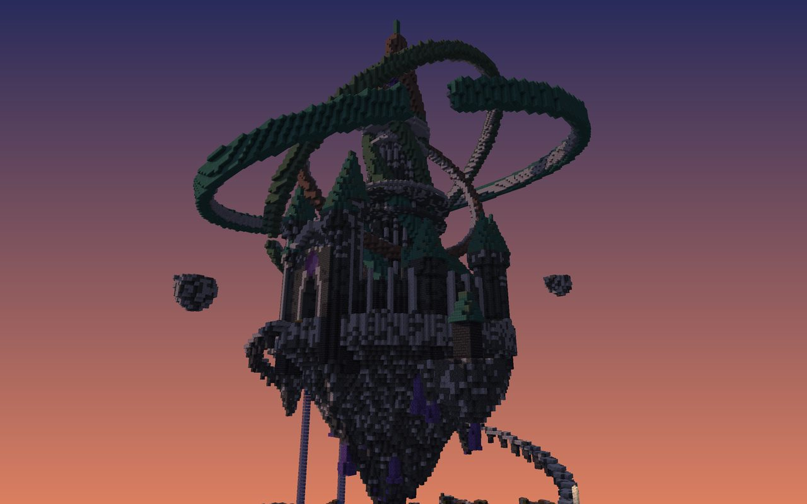
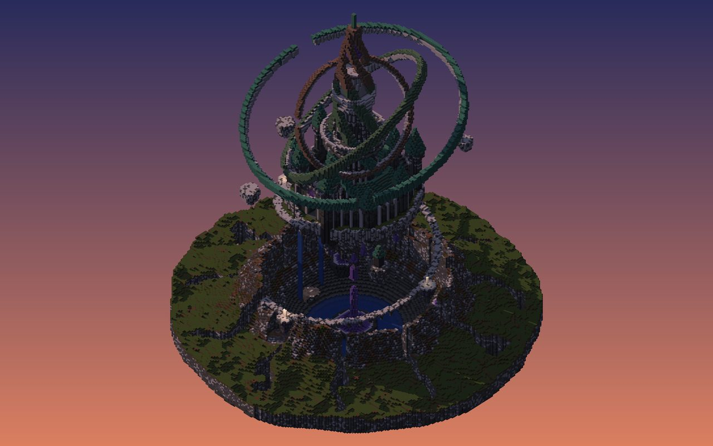
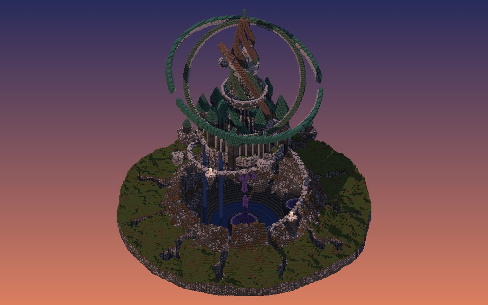

# Concept B: The Orrery of Ast

Massing model: [`scenes/concepts/arcane.py`](../../scenes/concepts/arcane.py), rendered with `python -m tools.voxel render scenes/concepts/arcane.py` (mood `dusk`).

| Iso SE | Iso SW |
|---|---|
|  |  |

## Art-direction sheet

**Statement.** A mage tore the summit off a mountain and hung it over the crater, and three copper rings 120 blocks across turn around the tower on top.

**Concept and story (3 lines).**
- The astronomer-mage Ast ripped the peak out of the highland and hung it, upside down, over the wound.
- On the floating summit stands a ring-walled castle of needle towers around the Spire. Copper ribs coil up the Spire to an open lantern that holds the Focus, a giant amethyst.
- Three armillary rings orbit it. A chain of amethyst shards rises from the geode at the bottom of the crater to the island's root, and a floating stair spirals up from the crater lip.

**Mood.** Violet twilight: cool sky, warm copper, amethyst glow, lantern points on the stair.

**Not generic because:**
1. It breaks "a castle sits on the ground". The castle hangs 80 blocks over a crater, and the hole it left is part of the build.
2. It breaks "the landmark is a tall tower". The landmark is a sphere of moving rings 120 across around the tower, so it reads as one object from every side and uses the canvas in all three dimensions.
3. It breaks "the approach is a road". The approach is a floating spiral stair, 1.25 turns, with four landings.

**References (take X from Y).**
- Take the leaning double spiral from Tatlin's Tower.
- Take the ring geometry (tilted, nested, thin bands with an inner lining) from armillary spheres and Jantar Mantar.
- Take the inverted-mountain island with hanging roots from Laputa: Castle in the Sky.
- Take the cluster of needle towers with steep cone roofs from Neuschwanstein.
- Take the crust → mantle → crystal layering for every exposed rock cut from real geode cross-sections.

**Canvas.**
- 208×250×208. The rings are 122 across (the castle); the highland is about 200 across.
- The Spire tip is at y230, about 200 over the highland.
- Built columns: 67% of the canvas and 95% of the central 128×128.

**Tiers.**
- T1, the Spire and the Focus: about 200 above the highland.
- T2, the needle towers and palace: about 119 above the highland. The ratio is 1.7.
- T3, the floating island deck and drifting rocks.
- T4, the shattered highland and the crater.

**Axis.** South Landing on the crater lip → floating stair (four landings) → Gatehouse (stepped gable, rose oculus) → court → the Spire → galleries → lantern and Focus.

**Sub-places (6).**
1. **The Shattered Highland**, eleven heaved plates with chasms between them.
2. **The Wound**, the crater with its lake, broken-open geodes and the amethyst conduit.
3. **The Floating Stair**, a ribbon with four lantern landings.
4. **The Summit Island**, an inverted mountain with amethyst stalactites and two waterfalls off its west edge.
5. **The Ring Court**, ring wall with a colonnade of pilasters, nine needle towers, two palace wings and the gatehouse.
6. **The Spire**, with a battered foot, two observatory galleries, four copper helix ribs, the lantern, the Focus, the needle and the three rings.

**Named elements (30).**
- Highland and crater: shattered plates, plate chasms, torn crater lip, crater lake, root geode, four lesser geodes, amethyst conduit chain, Landing.
- Stair and island: floating stair, four landings with lantern posts, island underside, amethyst stalactites, root crystal, two waterfalls, six drifting rocks, two lone observatory towers.
- Ring court: Gatehouse, nested gate recesses, rose oculus, two gate towers with trim shafts, ring wall, wall colonnade, nine needle towers, two palace wings.
- The Spire: Spire foot, lower gallery, upper gallery, four helix ribs, rib cage, the lantern, the Focus, the needle, ring 1 (oxidized), ring 2 (weathered), ring 3 (exposed), calcite ring linings.

**Palette roles.**

| Role | Blocks | Share |
|---|---|---|
| Base | deepslate bricks, tuff bricks, polished tuff, calcite (graded dark low → pale high) | ~55% |
| Accent | copper in three ages: oxidized ring 1, weathered ring 2, exposed ring 3 and ribs | ~25% |
| Trim | calcite and smooth quartz (pilasters, ring linings, gallery parapets) | ~10% |
| Feature | amethyst (Focus, conduit, geodes, stalactites) | ≤3% |
| Glow | lanterns on the stair, amethyst clusters, gallery lanterns | |
| Ground | grass/moss on far plates; tuff, calcite and coarse dirt on the torn lip | |

**Contrast.** Cool vs warm. The violet sky and the green oxidized copper are cool; the exposed copper and lanterns are warm. Each ring is a different copper age, so they separate at a distance.

**Detail map.**
- **A:** the Gatehouse, the lantern and the Focus, the galleries.
- **B:** the ring wall colonnade, needle tower crowns, the stair landings.
- **C:** the highland plates and the island underside.

**Light mood.** Dusk. Lanterns punctuate the stair spiral (it reads as a dotted helix at night); the Focus glows.

**Interiors.**

| Room | Job | Floor | Ceiling |
|---|---|---|---|
| Orrery Hall (Spire base) | A working model of the rings, astrolabes, desks | Radial inlay | |
| Lower gallery | Telescopes on the parapet | | |
| Upper gallery | Lens room | | |
| Lantern | The Focus, reached by the rib cage | | |
| Palace wings | Library (west), chart room (east) | Two-tone checker | Rib-vaulted |
| Geode grotto | Hidden room inside the root geode | | |

**Meeting the EliteCraft bar (craft only, no theme).**
- **Wall depth:** ring wall = plane + calcite pilasters (+1, every 5) + merlons + tower drums (+3); gatehouse with 3 nested recesses.
- **Detail density:** Spire fluting every 3 blocks of circumference; trim shafts on the gate towers.
- **Gradients:** deepslate → tuff → calcite → quartz upward, on both the walls and the Spire.
- **Interiors:** the galleries and the Orrery Hall are the showpiece rooms.

**Known failure modes.**
- From below, the island underside is a big dark mass that dominates the approach views.
- The rings must stay thin enough to look like instruments and thick enough to read. They are 5-6 wide now.
- Floating geometry needs a story (it has one) and safe player paths (the stair).

## Iteration log (three weakest things per pass)

| Pass | Sheet | Three weakest things a viewer would notice first | What changed |
|---|---|---|---|
| v1 | [sheet](img/arcane_sheet_v1.jpg) | The green ground disc dominates and the island looks small; the stair reads as debris; the Spire is too short against the rings | Spire raised and widened (foot r14, tip y240), rings thicker, the highland shattered into heaved plates with chasms |
| v2 | [sheet](img/arcane_sheet_v2.jpg) | The stair is still scattered stones; the gate is a hole in the wall; the walls are untreated | Continuous stair ribbon with 4 landings, a Gatehouse with nested recesses and a rose oculus, ring-wall colonnade and Spire fluting, torn rock on the crater lip, 3-wide waterfalls |
| v3 | [sheet](img/arcane_sheet_v3.jpg) | Stray arch rings fell to the ground under the gate; the landing camera stares into a step; the underside is too dark | Arch masks clipped, underside lightened (tuff/calcite), cameras reframed |
| v4 | [sheet](img/arcane_sheet_v4.jpg) | Remaining: the underside still dominates eye views from below; the needle towers read as plain green cones; the far highland is quiet | |
