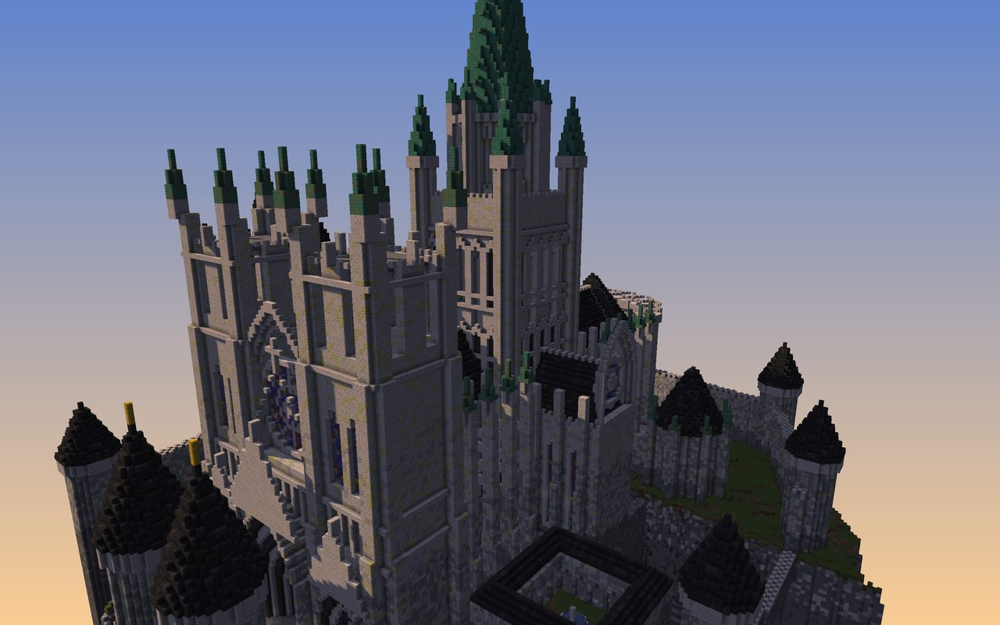
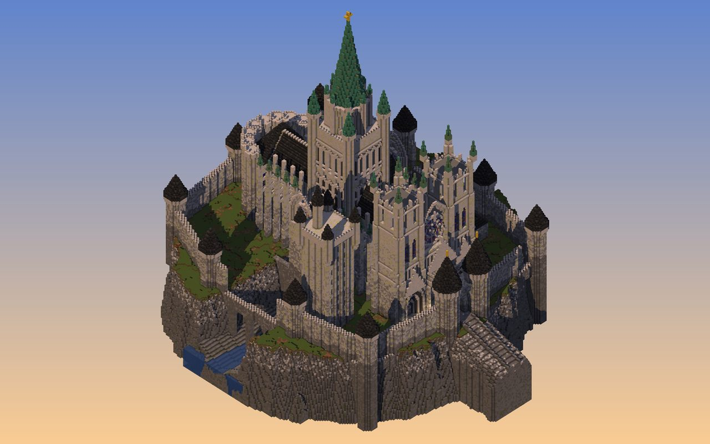
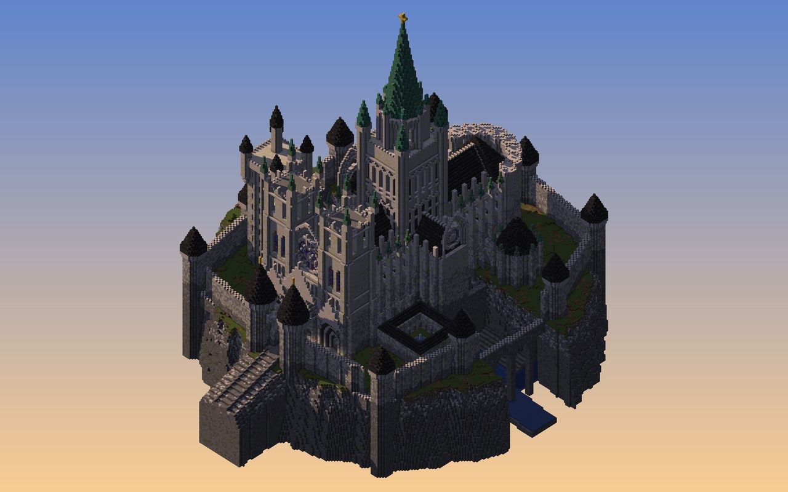
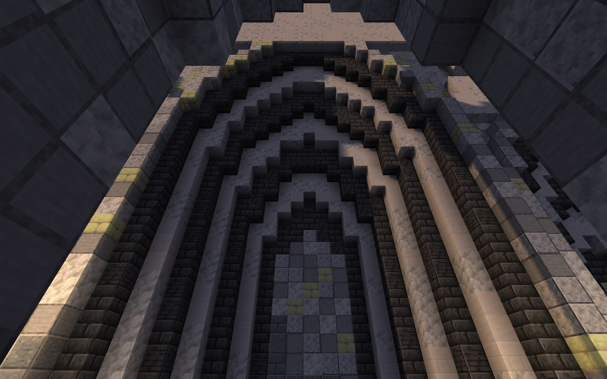
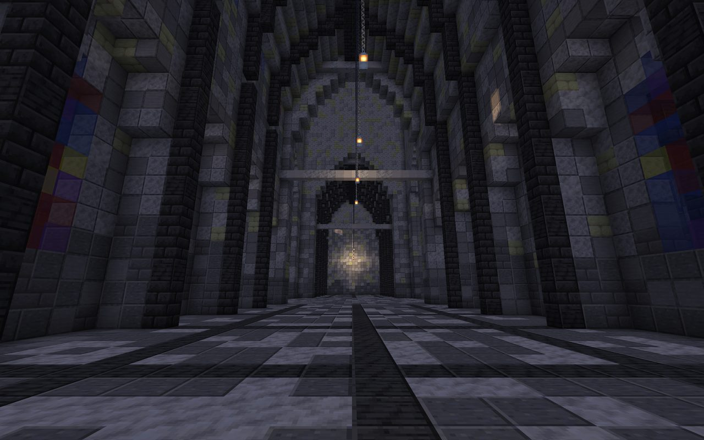
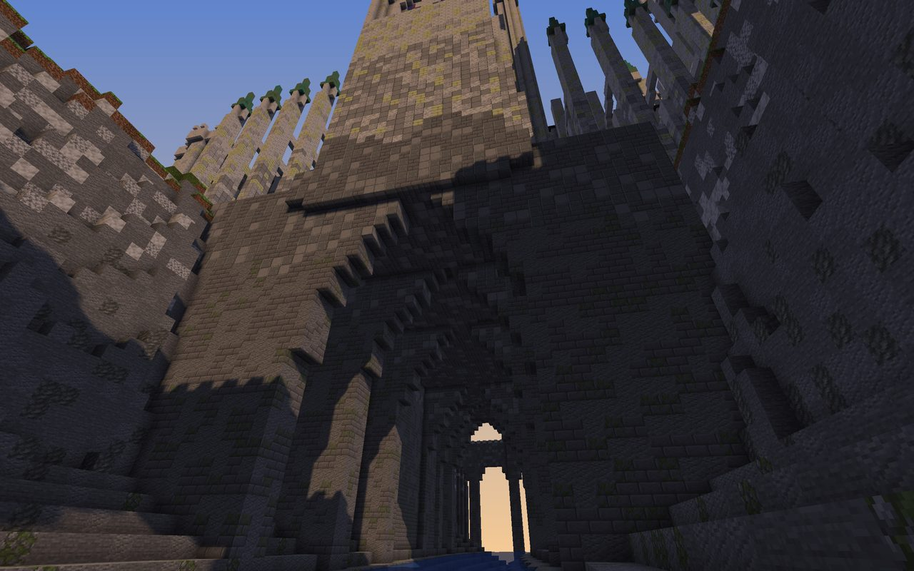
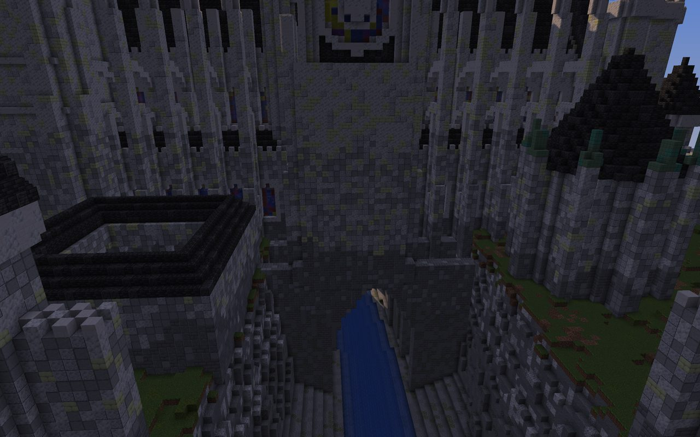

# Concept C: Our Lady of the Chasm

Massing model: [`scenes/concepts/gothic.py`](../../scenes/concepts/gothic.py), rendered with `python -m tools.voxel render scenes/concepts/gothic.py` (mood `golden`).

| Iso SW | Iso SE |
|---|---|
|  |  |

| Portal close-up | Nave | Under the crossing | Along the chasm |
|---|---|---|---|
|  |  |  |  |

## Art-direction sheet

**Statement.** An earthquake split the plateau under the cathedral, so the bishops bridged the wound: the crossing hangs over a gorge on arched legs.

**Concept and story (3 lines).**
- The nave stands on the south lip and the fortified choir on the north lip.
- The crossing tower and both transept arms hang over the chasm on walls of arches that stride down to the river.
- A curtain wall with round towers rings the plateau and bridges the chasm on arcades at both ends. The river leaves in a waterfall off the east cliff.

**Mood.** Golden afternoon: warm limestone, slate-black roofs, green copper on the spire.

**Not generic because:**
1. It breaks "a cathedral on flat ground". The building is a bridge, and its structure (the legs) is the spectacle from the gorge.
2. It breaks "the castle is the keep". The fortress is a church: an Albi-style apse with round tower-buttresses and machicolations, a barbican, and a bishop's donjon.
3. It breaks "the twin towers are the tallest". The front towers are flat-crowned (Notre-Dame), and one copper flèche over the void carries the height.

**References (take X from Y).**
- Take the round tower-buttresses and machicolated crown around the apse from Albi Cathedral.
- Take the arch-legged bridge descending into a gorge from Ronda's Puente Nuevo.
- Take the flat-topped twin towers, gallery of kings and rose from Notre-Dame de Paris.
- Take the two-tier flying buttresses with pinnacled piers from Reims and Chartres.
- Take the round towers with conical slate roofs on a curtain wall from Carcassonne.

**Canvas.**
- 208×218×240. The curtain wall is about 156×178; the cathedral alone is 76×134.
- The flèche tip is at y214, about 170 over the plateau.
- Built columns: 70% of the canvas and 100% of the central 128×128.

**Tiers.**
- T1, the crossing flèche: about 166 above the plateau.
- T2, the twin towers: about 90 above the plateau. The ratio is 1.84.
- T3: the nave and choir ridges (y about 98), the donjon (y110-140).
- T4: the curtain towers (y about 84) and the cloister.

**Axis.** South spur road → barbican → parvis (medallion paving) → triple portal and rose → nave → crossing over the chasm → choir → fortified apse.

**Sub-places (6).**
1. **The Spur and Barbican.**
2. **The Parvis and West Front.**
3. **The Nave and the Crossing over the void.**
4. **The Chasm**: river, legs, two tiers of arches, the east fall.
5. **The Cloister**, east.
6. **The North Close**: choir, Albi apse, chapter house; and the bishop's donjon, west.

**Named elements (33).**
- Approach and walls: spur road, barbican twin towers, barbican portal, curtain wall, 9 round towers with slate cones, two chasm arcades.
- West front: parvis, medallion paving, lantern posts, triple portal (6 nested rings in the centre), portal gable with crockets, gallery of kings, west rose (19 across), front gable and cross, twin towers, stepped corner buttresses, belfry lancets.
- Nave and crossing: nave, aisles, flying buttresses (two tiers), pinnacled piers, clerestory lancets, crossing tower, crossing blind arcades, octagonal lantern, flèche with crockets, gold finial and cross.
- Chasm: transept arms, transept roses, bridge legs, upper arches, river, east waterfall.
- North close and outliers: choir, Albi apse, apse tower-buttresses, chapter house, cloister, cloister fountain, bishop's donjon, donjon bartizans, donjon watch turret.

**Palette roles.**

| Role | Blocks | Share |
|---|---|---|
| Base (limestone) | stone bricks → smooth stone → polished diorite → calcite with end-stone-brick warmth, graded by height | ~60% |
| Accent | deepslate tiles/bricks: roofs, vault ribs, portal rings | ~25% |
| Trim | calcite, smooth quartz, quartz bricks: pinnacles, string courses, parapets, tracery | ~8% |
| Feature | stained glass (blue/red/purple/yellow) | ~3% |
| Glow | lanterns on chains in every bay, portal lanterns, parvis posts | |
| Ground | grass, moss, coarse/rooted dirt, stone/andesite/tuff strata in the chasm | |

**Contrast.** Light vs dark value: pale limestone walls under near-black slate roofs. The warm stone is set against the single cool green spire, which is the far-read device.

**Detail map.**
- **A:** the triple portal, rose and gable; the crossing lantern and flèche; the apse crown.
- **B:** the nave flanks (pilasters every 7 plus flyers), tower faces (string courses, buttresses), the transept roses.
- **C:** the curtain wall runs and the cloister roofs.

**Light mood.** Golden hour by day. At night the rose and lancets glow from the bay lanterns inside.

**Interiors.**

| Room | Bays | Floor | Ceiling | Focal end |
|---|---|---|---|---|
| Nave and choir (already in the massing) | 7-block bays | Checker with a dark centre strip | Pointed barrel vault with deepslate transverse ribs | Crossing → apse lancets |
| Crossing | 4 great arches | | Lantern (open to y150) | |
| Transepts | | | | Rose windows over the void |
| Donjon | 4 timber floors | | | |
| Chapter house | Octagon | | Pyramidal roof | |
| Cloister galleries | Arcade every 4 | | | Fountain |

**Meeting the EliteCraft bar (craft only, no theme).**
- **Wall depth:** nave flank = wall + recessed lancet (−1, glass) + trim frame + buttress pilaster (+2, stepped +3) + free-standing flyer pier (+6). Front = 4 planes plus the porch.
- **Detail density:** pinnacle on every buttress, spiked roof crest every 2, merlons every 2, crockets every 4 on the flèche.
- **Gradients:** the stone lightens from mossy stone bricks at the foot to calcite and quartz at the crown.
- **Interiors:** a vaulted nave with ribs, a patterned floor and hanging lanterns, already built at massing level.

**Known failure modes.**
- It is the most conventional silhouette of the three: from the iso it reads as "a fine cathedral-castle". The chasm, which is the premise, shows only from the gorge and east views.
- The large flat curtain-wall runs need a detail pass.

## Iteration log (three weakest things per pass)

| Pass | Sheet | Three weakest things a viewer would notice first | What changed |
|---|---|---|---|
| v1 | [sheet](img/gothic_sheet_v1.jpg) | Square slab plateau with a floor plane; dark grey stone (not limestone); the twin spires nearly match the crossing (ratio 1.28) | Round plateau with void around it, south spur road, lighter warm limestone gradient, flat-crowned towers, flèche raised to y214 |
| v2 | [sheet](img/gothic_sheet_v2.jpg) | The chasm (the premise) is invisible; the nave is closed off from the crossing; cameras pressed against walls | Chasm widened to 46, curtain wall becomes a low arcade over the chasm, great crossing arches, nave and choir open through |
| v3 | [sheet](img/gothic_sheet_v3.jpg) | The crossing tower faces are flat 20×40 planes; the interior is dark; there is no shot that sells the chasm | Blind arcades and open belfry panels on the crossing, longer lantern chains, gorge camera |
| v4 | [sheet](img/gothic_sheet_v4.jpg) | The parvis camera is a crop of a wall; the gorge camera is boxed in | Portal close-up camera, east "along the chasm" hero |
| v5 | [sheet](img/gothic_sheet_v5.jpg) | Remaining: the chasm still doesn't read from the iso; the curtain-wall runs are plain; the parvis is shallow (14 blocks) | |
