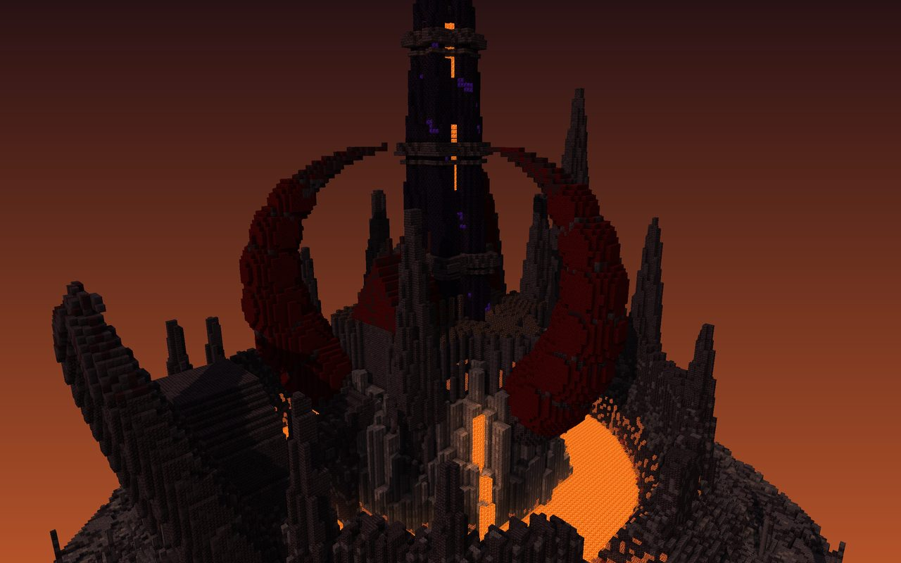
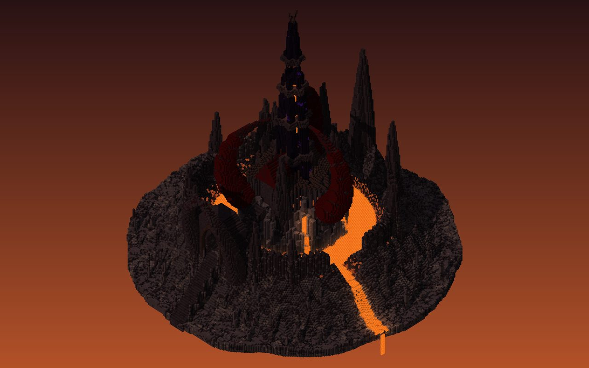
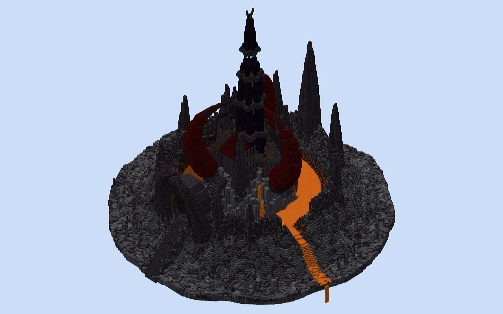

# Concept A: Vharzul, the Ember Throne

Massing model: [`scenes/concepts/infernal.py`](../../scenes/concepts/infernal.py), rendered with `python -m tools.voxel render scenes/concepts/infernal.py` (mood `ember`).

| Iso (ember) | Iso (daylight, for reading the forms) |
|---|---|
|  |  |

## Art-direction sheet

**Statement.** A three-horned claw of black stone rises out of a burning caldera and grips a twisted needle tower with a lava heart.

**Concept and story (3 lines).**
- A fire-lord grew his citadel on the basalt plug in the middle of a living caldera.
- The caldera rim is his outer wall. The east rim has burst (the Breach), and the lava lake bleeds over the edge of the world.
- Three obsidian horns curl inward from the star-fort and hold the Fang, a twisted keep whose hollow core is a column of lava.

**Mood.** Ember dusk with light from below: the lake, the falls and the heart throw orange up onto black stone.

**Not generic because:**
1. It breaks "castle on a hill". The castle sits in a hole: the land rises into a rim and drops into a lava lake, and the keep stands on an island of basalt organ pipes.
2. It breaks "towers are cylinders with cones". The tower is a six-pointed star prism twisted 55°. The secondary masses are curved horns, not towers.
3. It breaks "walls are straight". The defences are a star fort inside a crater rim with 11 rock fangs, and the gate is a mouth (the Maw) with crossing tusks.

**References (take X from Y).**
- Take the chapel on a volcanic plug from Le Puy-en-Velay (Saint-Michel d'Aiguilhe).
- Take the hexagonal organ-pipe columns from the Giant's Causeway and Fingal's Cave.
- Take the far-read silhouette of one dark needle over a fire-lit plain from Barad-dûr.
- Take the star-fort plan from Bourtange and Palmanova.
- Take the "lava lights the architecture from below" mood from Dark Souls' Lost Izalith.

**Canvas.**
- 208×204×208. The rim is 128 across (the castle); the island is about 200 across.
- The Fang tip is at y198, about 182 over the ash plain.
- Built columns: 74% of the canvas and 100% of the central 128×128.

**Tiers.**
- T1, the Fang (keep): about 182 above the plain.
- T2, the horns: tips at y118, about 102 above the plain. The ratio is 1.78, which passes the 1.7 floor.
- T3: the twisted spires and rim fangs (y 90-130), the Forge Hall and the Maw (y 70-100).
- T4: the star wall and the ash plain.

**Axis.** South stair foot → processional stair up the rim → the Maw (gate) → bridge over the lava lake → Forge Hall → the Fang.

**Sub-places (6).**
1. **The Ash Plain**, with the Field of Spears (basalt spike forest) and the floating underbelly.
2. **The Rim**, a jagged ring with 11 fangs, the north crown and the Breach gorge.
3. **The Lake**, with sea stacks and four lava falls off the plug.
4. **The Star Bailey**, a six-point star wall with a gilded crown course.
5. **The Forge Hall**, steep red roof, ridge spikes and a lava floor channel.
6. **The Fang**, with its lava heart, slit galleries, star collars and the crown chamber.

**Named elements (31).**
- Approach and rim: processional stair, Maw gatehouse, crossing tusks, rim crest, north crown, 11 rim fangs (counted as one), the Breach, the Breach lava channel, the edge fall, the Field of Spears, floating underbelly, ash plain.
- Lake and plug: lava lake, sea stacks, four plug falls, basalt organ-pipe plug, lava bridge, bridge piers.
- Bailey and towers: star wall, gilded crown course, wall pilasters, magma slits, three twisted spires.
- Horns: three horns, red rib rings.
- The Fang: Forge Hall, ridge spikes, lava floor channel, the Fang, four star collars, valley slits, lava heart column, crown chamber, gilded finial thorns.

**Palette roles.**

| Role | Blocks | Share |
|---|---|---|
| Base | blackstone, polished blackstone bricks, cracked bricks, basalt, smooth basalt | ~60% |
| Accent | red nether bricks (horn ribs), nether bricks, magma | ~20% |
| Trim | gilded blackstone (crown course, pilaster heads, finial) | ~5% |
| Feature | crying obsidian in the Fang | ≤2% |
| Glow | lava, magma, shroomlight, lantern | |
| Ground | ash: smooth basalt, basalt, tuff, blackstone | |

- Contrast: hot vs cold value. Incandescent orange low (lake, falls, heart) against near-black high masses.
- The gradient is deliberately inverted: bright and hot at the bottom, dark at the top.

**Detail map.**
- **A (densest):** the Maw (nested tusk frame), the Fang's crown chamber and finial, the bridge-head.
- **B:** the star wall (pilasters every 3, slits), horn ribs, Forge Hall flanks (buttress spikes every 3).
- **C (quiet):** the ash plain and the outer rim slopes.

**Light mood.** Ember dusk. Every light is lava or magma (it reads at night from the far side of the map). There are no torches.

**Interiors.**

| Room | Job | Bays | Focal end | Floor | Ceiling |
|---|---|---|---|---|---|
| Forge Hall | Anvils, smithing, war council | 3-block buttress rhythm | The Fang's door | Lava channel between polished blackstone | Steep red roof trusses |
| The Fang shaft | Spiral stair around the lava heart | One landing every 8 | The heart | | |
| Crown chamber | Throne, open to the sky through 6 arches | | | | |
| Gallery collars | Lookout rings | | | | |
| Under-rim cells | Gaol | | | | |

**Meeting the EliteCraft bar (craft only, no theme).**
- **Wall depth:** star wall = plane + pilasters (+1, every 3) + gilded crown (+1) + magma slits (−1) + star points (+2..3).
- **Detail density:** a 3-block rhythm on all bailey walls; spike rows on every ridge.
- **Gradients:** basalt → blackstone → polished bricks → gilded, low to high; lava glow inverts the value read.
- **Interiors:** the Forge Hall and the Fang's shaft are the two showpiece rooms, lit only by lava.

**Known failure modes.**
- Black on black loses all detail in daylight and in GUI-scale screenshots, so the scene needs the ember glow to read.
- Black, red and fire sits close to the EliteCraft reference palette. The concept owns it (volcano, not cathedral), but a critic may call it derivative.
- The bailey is narrow (about 5-8 blocks between the Fang and the wall).

## Iteration log (three weakest things per pass)

| Pass | Sheet | Three weakest things a viewer would notice first | What changed |
|---|---|---|---|
| v1 | [sheet](img/infernal_sheet_v1.jpg) | Unreadably dark; crying obsidian reads as purple noise; the high rim hides the lake | Brighter ember mood, a lower rim, a raised lake |
| v2 | [sheet](img/infernal_sheet_v2.jpg) | Weak rim skyline; thin horns; cameras inside blocks | 11 rim fangs, thicker horns, sparse veins, cameras moved |
| v3 | [sheet](img/infernal_sheet_v3.jpg) | Plain cone keep; flat gate slab; spawn view is a stair wall | Keep collars, the Maw with crossing tusks, new spawn and heart cameras |
| v4 | [sheet](img/infernal_sheet_v4.jpg) | The horns (y150) nearly match the Fang (y166), so there is no hierarchy; flat untreated star wall; plain hall flanks | Horns lowered to y118, Fang raised to y194 with a gilded finial, wall pilasters and magma slits, hall buttress spikes |
| v5 | [sheet](img/infernal_sheet_v5.jpg) | The bailey camera sits in rock; the bailey is a 2-block slot between the Fang and the wall | Camera moved |
| v6 | [sheet](img/infernal_sheet_v6.jpg) | Remaining: the ash ring is large and featureless; the approach eye view sees only the rim (the Fang is hidden until the gate); still very dark by day | Fang base slimmed (r15.5 → 13) to open the bailey |
