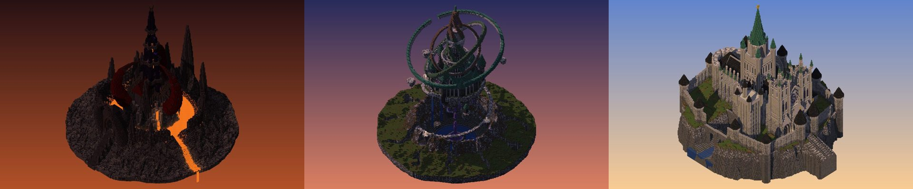
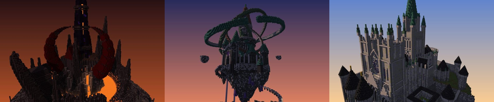

# Castle v2: three concepts

This round answers the v1 verdict ("boring and almost empty… make a statement").

- v1 used 17% of the canvas and stood 64 tall.
- Each concept here fills the central 128×128 completely, with land around it, and stands 170-200 blocks tall.
- All three follow `docs/voxel-playbook.md` §2-4.
- EliteCraft (`docs/references/elitecraft/analysis.md`) was used only to calibrate craft: depth layers, detail density, palette cohesion and hierarchy. No theme or composition comes from it.

Massings live in `scenes/concepts/`. Render with `python -m tools.voxel render scenes/concepts/<name>.py`; `--mood` is new, see `docs/voxel-studio.md`.

## Side by side

Iso views, left to right: Infernal (ember), Arcane (dusk), Gothic (golden).

Hero eye views, same order.

| | **A. Vharzul, the Ember Throne** | **B. The Orrery of Ast** | **C. Our Lady of the Chasm** |
|---|---|---|---|
| Statement | A three-horned claw of black stone rises out of a burning caldera and grips a twisted needle tower with a lava heart. | A mage tore the summit off a mountain and hung it over the crater; three copper rings 120 across turn around the tower on top. | An earthquake split the plateau, so the bishops bridged it: the crossing hangs over a gorge on arched legs. |
| Sheet | [castle-v2-infernal.md](castle-v2-infernal.md) | [castle-v2-arcane.md](castle-v2-arcane.md) | [castle-v2-gothic.md](castle-v2-gothic.md) |
| Massing | [infernal.py](../../scenes/concepts/infernal.py) | [arcane.py](../../scenes/concepts/arcane.py) | [gothic.py](../../scenes/concepts/gothic.py) |
| Landmark height over ground | ~182 (Fang) | ~200 (Spire) | ~170 (flèche) |
| Tier ratio, T1:T2 | 1.78 (Fang : horns) | 1.70 (Spire : needle towers) | 1.84 (flèche : twin towers) |
| Columns built, whole canvas / central 128² | 74% / 100% | 67% / 95% | 70% / 100% |
| Blocks | 1.07 M | 0.79 M | 1.55 M |
| Sub-places / named elements | 6 / 31 | 6 / 30 | 6 / 33 |
| Palette contrast | Hot low vs dark high | Cool copper and violet vs warm copper and lanterns | Pale limestone vs slate black, plus one green spire |
| Iterations | 6 ([v1](img/infernal_sheet_v1.jpg) … [v6](img/infernal_sheet_v6.jpg)) | 4 ([v1](img/arcane_sheet_v1.jpg) … [v4](img/arcane_sheet_v4.jpg)) | 5 ([v1](img/gothic_sheet_v1.jpg) … [v5](img/gothic_sheet_v5.jpg)) |
| Remaining three weakest | Ash ring featureless; approach sees only the rim; dark by day | Underside dominates views from below; plain green tower cones; quiet far highland | Chasm not legible in iso; plain curtain runs; shallow parvis |

The full render sets (iso, top and all eye cameras for every iteration) are in `.mcdev/voxel/out/concepts/<name>/vN/`, which is not in git. Compressed copies of the final views are in `img/`.

## Recommendation: B, the Orrery of Ast

1. **It is the strongest statement and the least generic.**
   - Nobody's mental default for "castle" is a hanging mountain inside three planetary rings.
   - It is the only concept whose identity holds at every distance: a ring-sphere far off, a stair spiral at mid range, the gatehouse and galleries up close.
2. **It uses the canvas in three dimensions, not only in plan.**
   - The rings span 122 blocks and the Spire is the tallest landmark (about 200 over ground).
   - The crater below is a second build space: geodes, a lake, the conduit.
   - For the map it gives vertical play: the stair, the galleries, falls off the island.
3. **Its palette is its own and ages well.**
   - Copper, tuff, calcite and amethyst sit far from the black/red Nether look.
   - Copper ageing is a free storytelling device: each ring is a different age.

**Fallback: C, Our Lady of the Chasm.**
- It is the safest to build to high quality: most facade, most interiors already in the massing, and the clearest wall-depth system.
- The chasm bridge keeps it from being a stock cathedral.
- But it is the most conventional silhouette, and the premise reads only from the gorge views.
- Pick it if the floating geometry of B proves hard to make playable.

**Not recommended as the main castle: A, Vharzul.**
- It has the most aggressive silhouette, the best night read and good tier discipline.
- But its black/red/lava palette is the closest of the three to the EliteCraft Nether cathedral the user asked us not to drift towards, and it is hard to read by day.
- Its parts could be harvested elsewhere (the lava heart, the star collars, the Maw) for an enemy or arena build.

## If B is chosen, the next pass

- Break up the island underside with terraces, root arches and lit grottos, so the views from below are not one dark mass.
- Give the needle towers distinct crowns: bell lanterns, telescope domes, a copper armillary on one.
- Detail the highland plates with ruined outer observatories along the axis.
- Then do interiors per the sheet: the Orrery Hall, the galleries, the geode grotto.
